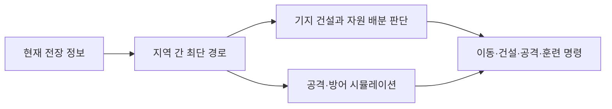

# NYPC 2026 마스터 트랙 게임 에이전트

병력을 이동하고 기지를 건설해 상대 본부를 파괴하는 전략 게임의 에이전트를 개발했습니다.
상황별 판단 규칙을 직접 설계하는 휴리스틱 방식으로 구현했으며, C++ 에이전트와 Python 대전·분석 도구를 만들었습니다.

**예선 19위로 본선 진출 · 본선 23팀 중 22위**

| 항목 | 내용 |
| --- | --- |
| 대회 | 넥슨 영 프로그래머스 컵(NYPC) 2026 마스터 트랙 |
| 참가 형태 | 1인 팀 |
| 팀명 | 예쁜 말 고운 말 - 1558 |
| 담당 범위 | 전략 설계, 에이전트 구현, 로컬 대전 환경과 리플레이 분석 도구 개발 |
| 주요 기술 | C++, Python, 그래프 알고리즘, 전투 시뮬레이션, 멀티프로세싱 |

[공식 예선 결과](https://new.nypc.co.kr/ko/rank/2026/master/qualification?page=1) · [공식 본선 결과](https://new.nypc.co.kr/ko/rank/2026/master/finals?page=2)

## 어떤 문제를 푸는 게임인가요?

여러 지역이 길로 연결된 전장에서 두 에이전트가 대결합니다.
매 턴 병력 이동, 기지 건설과 업그레이드, 병력 훈련을 결정해 상대 본부를 파괴해야 합니다.
금화와 병력이 제한되어 있어 공격할 대상뿐 아니라 기지에 투자할 시점, 방어에 남길 병력과 이동 시간을 함께 판단해야 합니다.

## 저장소 구성

루트의 `main.c++`와 `judge.py`는 예선 구현입니다.
본선은 시야와 입력 규칙이 달라 [NEXT_VISION/](NEXT_VISION/README.md)에서 별도로 관리합니다.
아래 핵심 구현 설명은 예선 에이전트를 중심으로 정리했습니다.

| 구분 | 예선 | 본선 |
| --- | --- | --- |
| 관측 정보 | 전체 전장 상태 | 아군 전사·건물 주변의 제한된 시야 |
| 최대 진행 턴 | 200 | 400 |
| 기준 코드 | [main.c++](main.c++) | [NEXT_VISION/master_main.cpp](NEXT_VISION/master_main.cpp) |
| C++ 기준 | C++17 | C++20 |
| 로컬 대전 환경 | [judge.py](judge.py) | [NEXT_VISION/judge.py](NEXT_VISION/judge.py) |

## 전략의 처리 흐름



## 주요 고민과 구현

### 1. 이동 경로와 기지 건설을 함께 판단

전장 구조가 경기 중 바뀌지 않아, 모든 지역 사이의 최단 경로를 구하는 Floyd–Warshall 알고리즘으로 거리와 다음 이동 지점을 미리 계산했습니다.
이 정보를 기지 후보 선택, 병력 지원과 공격 경로 판단에 재사용했습니다.

기지는 가까운 곳이라는 이유만으로 건설하지 않도록 했습니다.
이동·건설에 필요한 시간과 비용, 유지비와 남은 턴의 예상 수익을 함께 계산해 자원을 배분했습니다.

### 2. 전투를 미리 계산해 공격·방어 병력 결정

상대와의 거리나 현재 병력 수만으로는 이동 중인 지원 병력과 추가 훈련의 영향을 판단하기 어려웠습니다.
병력 도착, 건물 내구도, 전투 피해와 자원 변화를 턴 단위로 계산하는 시뮬레이션을 구현했습니다.
이를 이용해 공격에 필요한 병력과 방어를 위해 남겨야 할 병력을 구했습니다.

이미 건설이나 공격에 투입한 병력이 다음 턴의 판단으로 다른 역할에 재배치되지 않도록 이동 목적을 유지했습니다.
서로 다른 위치의 병력을 모아 공격할 때는 이동 시간을 고려해 도착 시점을 맞추도록 했습니다.

관련 코드: [예선 에이전트](main.c++)

### 3. 전략을 비교하고 실패 원인을 확인할 평가 환경 구축

Python으로 게임 규칙을 구현한 로컬 대전 환경을 만들었습니다.
맵 생성, 이동·건설·훈련·전투 처리, 후보 전략 간 반복 대전과 토너먼트 평가를 지원합니다.
여러 맵에서 진영을 번갈아 배정하며 후보 전략의 승수와 점수를 비교했습니다.

CSV 경기 기록과 HTML 리플레이 뷰어로 어느 시점의 판단이 패배로 이어졌는지 확인했습니다.
고정된 맵이나 기록된 상대 명령을 재생하는 기능도 구현해 특정 상황을 다시 살펴볼 수 있도록 했습니다.

관련 코드: [로컬 대전과 평가](judge.py) · [리플레이 뷰어](viewer_template.html) · [후보 전략](pool/)

## 결과와 돌아본 점

예선에서 19위로 본선에 진출했고, 본선에서는 23팀 중 22위를 기록했습니다.
전략을 구현하는 일과 함께, 변경한 전략을 반복해서 비교하고 경기 기록에서 원인을 찾는 과정의 중요성을 경험했습니다.

예선은 상대 정보를 모두 볼 수 있었지만 본선에서는 시야 밖의 정보를 알 수 없었습니다.
이에 맞춰 입력 처리, 전략과 평가 환경을 함께 조정해야 했으며, 관측할 수 있는 정보의 범위를 전략의 전제로 다루는 것이 중요했습니다.

로컬 대전 환경은 공개 규칙을 바탕으로 직접 구현한 시뮬레이터입니다.
로컬 승률만으로 공식 대회 환경에서의 성능을 보장할 수는 없습니다.
또한 현재 토너먼트는 경기마다 맵을 생성하고 진영을 번갈아 배정하므로, 같은 맵에서 진영만 바꾸는 짝 비교를 보완할 여지가 있습니다.

## 주요 파일

| 파일·폴더 | 역할 |
| --- | --- |
| [main.c++](main.c++) | 예선 최종 휴리스틱 에이전트 |
| [GameRules.md](GameRules.md) | 예선 규칙 정리 |
| [judge.py](judge.py) | 맵 생성, 로컬 대전, 토너먼트와 경기 기록 생성 |
| [pool/](pool/) | 비교 평가에 사용한 후보 전략 |
| [replay_bot.cpp](replay_bot.cpp) | 경기 기록 재생을 위한 도구 |
| [viewer_template.html](viewer_template.html) | HTML 리플레이 템플릿 |
| [NEXT_VISION/](NEXT_VISION/README.md) | 본선 규칙에 맞춘 에이전트와 분석 도구 |

## 실행 방법

예선 실행에는 Python 3.11 이상과 C++17을 지원하는 `g++`이 필요합니다.
Python 패키지는 `numpy`, `scipy`, `tqdm`을 사용합니다.

```bash
pip install numpy scipy tqdm
python judge.py main.c++ pool/110584.cpp --games 100 --workers 8 --seed 42
```

소스 파일은 필요할 때 자동으로 컴파일됩니다. 저장소의 `sim/out/`에서 생성된 경기 기록과 HTML 리플레이를 확인할 수 있습니다.

기록된 경기나 상대 명령 재생:

```bash
python judge.py main.c++ pool/110584.cpp --map-file <경기-로그-파일>
python judge.py main.c++ --replay <경기-로그-파일> --replay-side B
```

본선 기준 소스 빌드와 로컬 대전:

```bash
g++ -std=c++20 -O2 -Wall -Wextra -pedantic NEXT_VISION/master_main.cpp -o NEXT_VISION/master_main
python NEXT_VISION/judge.py NEXT_VISION/master_main.cpp NEXT_VISION/sample_ai_imitation.cpp --games 1 --seed 42
```

본선의 파일 설명과 리플레이 분석 방법은 [본선 폴더 안내](NEXT_VISION/README.md)에 정리했습니다.
